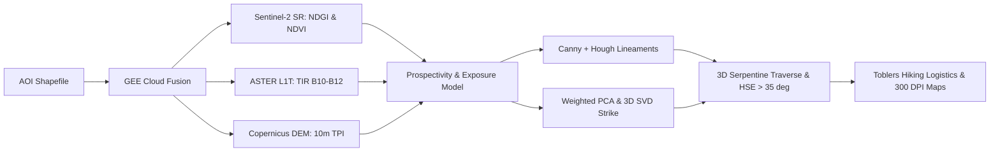
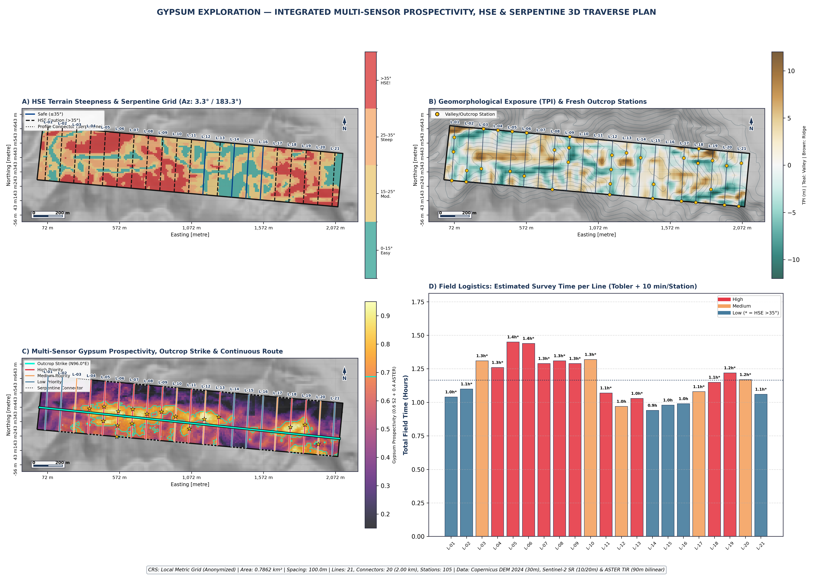

# Gypsum Prospectivity, Structural Analysis & 3D Traverse Planning

[](https://colab.research.google.com/github/saasajjadi/Gypsum-Prospectivity-Traverse-GIS/blob/main/notebooks/Gypsum_Prospectivity_Traverse_GIS.ipynb)


An end-to-end **Multi-Sensor Remote Sensing, Geospatial Data Science, and Structural Geology** pipeline for automated gypsum prospectivity mapping, 3D structural orientation analysis, HSE terrain risk assessment, and serpentine field traverse planning using **Google Earth Engine (GEE)** and Python.

---

## Pipeline Architecture



---

## Key Features & Scientific Workflow

* **Multi-Sensor Data Fusion:** Integrates **Sentinel-2 SR Harmonized** (`NDGI` & `NDVI` vegetation masking), **ASTER L1T TIR** (`B10, B11, B12`), and **Copernicus DEM GLO-30 (2024)** resampled to 10 m.
* **Geomorphological Exposure Modeling:** Computes multi-scale **Topographic Position Index (TPI)** and multi-directional hillshading to isolate fresh rock exposures from transported cover.
* **Automated 3D Structural Analysis:** Extracts structural lineaments via **Canny Edge Detection** and **Probabilistic Hough Transform**, coupled with **Weighted PCA** for strike orientation and **3D SVD** plane fitting.
* **3D Serpentine Traverse & HSE Logistics:** Generates continuous zigzag survey profiles perpendicular to strike, flags steep slopes (**HSE > 35°**), and estimates 3D walking times using **Tobler's Hiking Function**.
* **Publication-Grade Cartography:** Exports 300 DPI multi-panel prospectivity dashboards, structural rose diagrams, and prioritized profile maps.

---

## Core Mathematical Formulations

1. **Normalized Difference Gypsum Index (NDGI — Sentinel-2):**
   $$\text{NDGI} = \frac{\rho_{\text{SWIR1}} - \rho_{\text{SWIR2}}}{\rho_{\text{SWIR1}} + \rho_{\text{SWIR2}}}$$

2. **3D Field Walking Velocity (Tobler's Hiking Function):**
   $$W = 6 \exp\left(-3.5 \left|\frac{dh}{dx} + 0.05\right|\right)$$

---

## Sample Outputs (Anonymized)

> **Data Privacy & Confidentiality Note:** Due to confidentiality agreements, raw shapefiles, field coordinates, and exact geographic locations have been omitted. All maps use a local metric grid (relative meters).

### 1. Integrated 4-Panel Prospectivity, HSE & Logistics Dashboard


### 2. Structural Lineaments & Rose Diagram


### 3. Gypsum Outcrop Strike Axis & 100m Serpentine Profiles


---

## Quick Start Guide

1. Click the **Open In Colab** badge above.
2. In **Cell 1 (`CONFIG`)**, replace `'YOUR_GEE_PROJECT_ID'` with your Google Earth Engine Cloud Project ID.
3. Run the notebook and upload a **zipped Shapefile** (`.shp`, `.shx`, `.dbf`, `.prj`) of your Area of Interest (AOI) in **Cell 2**.
4. All 300 DPI maps and outputs are generated automatically in `/content/Gypsum_Pipeline_Outputs`.

---

## Citation

```bibtex
@software{Sajjadi_Gypsum_Prospectivity_Traverse_GIS_2026,
  author       = {Sajjadi, Seyed Ali Akbar},
  title        = {Gypsum Prospectivity, Structural Analysis & 3D Traverse Planning},
  year         = {2026},
  url          = {https://github.com/saasajjadi/Gypsum-Prospectivity-Traverse-GIS}
}
```
