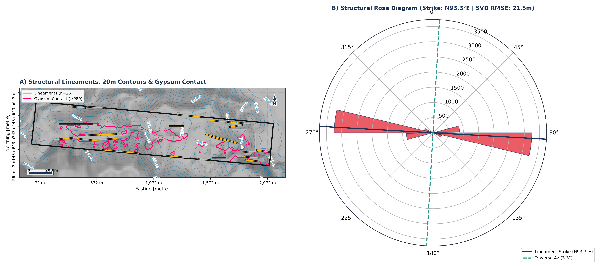
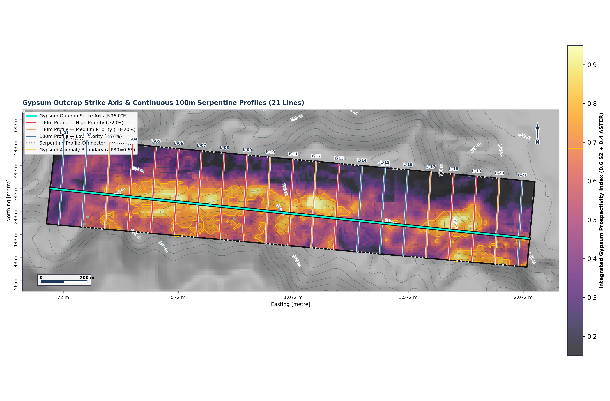

# GeoAI Gypsum Exploration Pipeline

An end-to-end **GeoAI & Remote Sensing** pipeline for automated gypsum prospectivity mapping, structural lineament analysis, HSE terrain assessment, and 3D serpentine field traverse planning using **Google Earth Engine (GEE)** and Python.

---

## Key Features

- **Multi-Sensor Fusion:** Integrates **Sentinel-2 SR Harmonized** (NDGI & NDVI vegetation masking), **ASTER L1T TIR** thermal bands (`B10, B11, B12`), and **Copernicus DEM GLO-30 (2024)** resampled to 10 m.
- **Geomorphological Exposure (TPI):** Computes Topographic Position Index (TPI) and multi-directional hillshade to identify valleys and fresh rock outcrops.
- **Structural Analysis:** Automated lineament extraction via **Canny Edge Detection** and **Probabilistic Hough Transform**, coupled with **Weighted PCA** for gypsum outcrop strike orientation and **3D SVD** plane fitting.
- **3D Serpentine Traverse & HSE Logistics:** Generates continuous zigzag (serpentine) survey lines perpendicular to strike, flags steep terrain (**HSE > 35°**), and estimates 3D walking and logging times using **Tobler's Hiking Function**.
- **Publication-Grade Cartography:** Exports 300 DPI integrated dashboards, structural rose diagrams, and prioritized profile maps.

---

## Sample Outputs (Anonymized)

> **Data Privacy Note:** Due to confidentiality agreements, raw shapefiles, field coordinates, and exact geographic locations have been omitted. The maps below use a local metric grid (relative meters).

### 1. Integrated 4-Panel Prospectivity, HSE & Logistics Dashboard

### 2. Structural Lineaments & Rose Diagram

### 3. Gypsum Outcrop Strike Axis & 100m Serpentine Profiles

---

## How to Run

1. Click the **Open In Colab** badge above.
2. In Cell 1 (`CONFIG`), replace `'YOUR_GEE_PROJECT_ID'` with your own Google Earth Engine Cloud Project ID.
3. Run the notebook and upload a **zipped Shapefile** (`.shp`, `.shx`, `.dbf`, `.prj`) of your Area of Interest (AOI) when prompted in Cell 2.
4. All 300 DPI maps and outputs will be generated automatically in `/content/GeoAI_Gypsum_Final_Outputs`.

---

## Dependencies

See `requirements.txt` for the full list of Python packages (`earthengine-api`, `geopandas`, `rasterio`, `scikit-image`, `scipy`, `shapely`, `matplotlib`).
